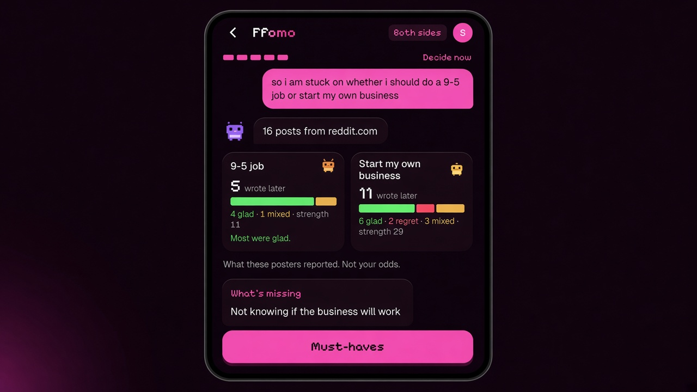
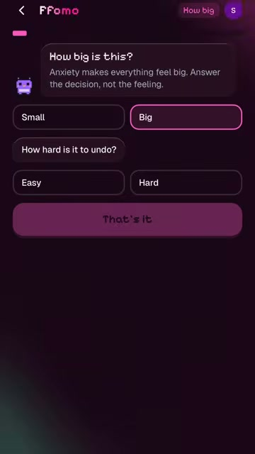
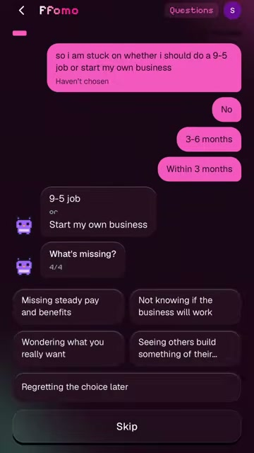
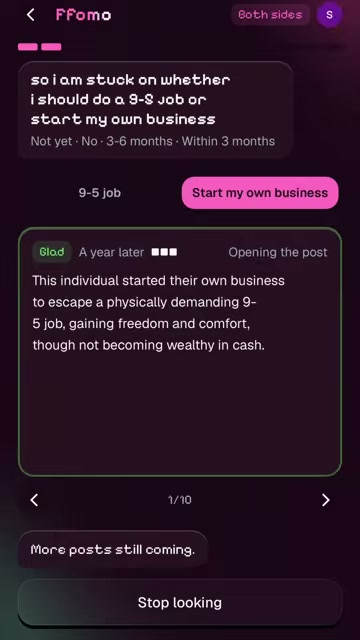
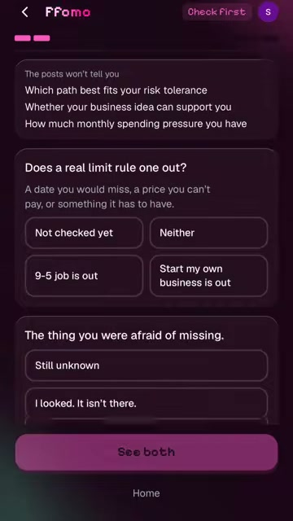
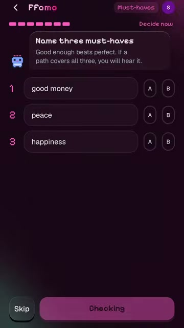
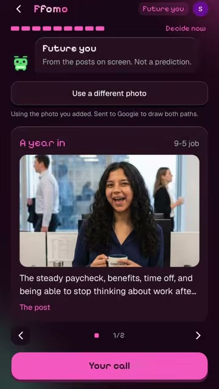
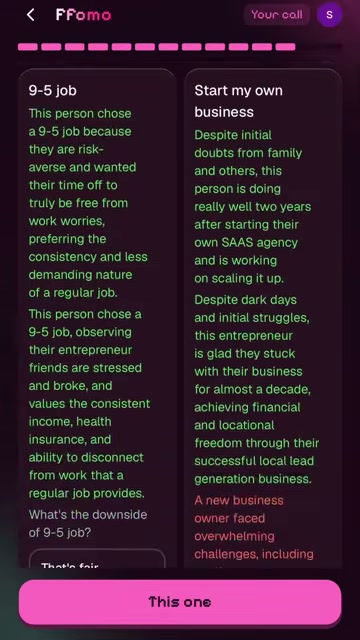
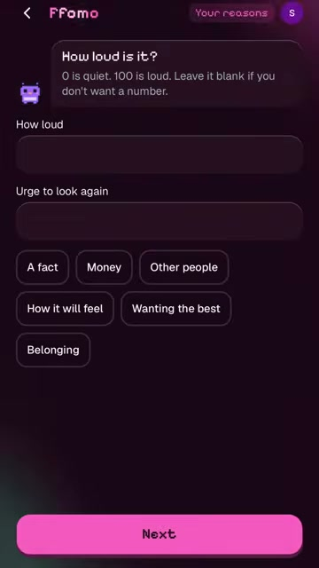
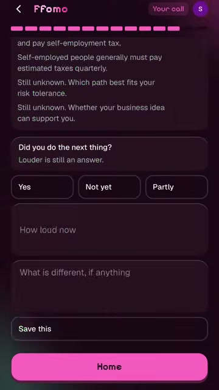

# Ffomo

Before or after a decision, Ffomo shows how it turned out for people who already made it, what they wish they had known, and where each path tends to lead. Then you decide.

The name means fuck FOMO. The product says **Ffomo**.

Live: [ffomo.vercel.app](https://ffomo.vercel.app)

<p align="center">
  
</p>

A 9-5 and a business of your own, from one real session. Sixteen later posts. The job side was mostly glad. The business side was longer, and mixed. The screen does not pick.

## What a session does

You type the decision in your own words, and you say whether you have already chosen. The app names both paths in those words. It does not ask you to pick a mode from a menu.

This is the same 9-5 run, in order.

| Step | What you see |
| --- | --- |
| Say it | The decision, typed or spoken. A photo here is of the thing, not a face. |
| How big | Small or big, and easy or hard to undo. A shirt does not become a research project. |
| Questions | A few questions in the language of that fork. Skip is allowed. |
| Both paths | Follow-up posts from people who lived each path. Each one is a sentence, how long later, and a link. |
| Check first | Spec pages only, link-checked. Then: does a real limit rule one path out? |
| The meter | Raw count and story strength on each side. Labeled "what these posters reported." There is no winner. |
| Must-haves | Three things that would make a path good enough. |
| Future you | A week, a year, and five years, written only from the posts on screen. A photo is a separate ask. |
| Your call | Both columns stay up. You tap the one you are keeping. |
| Your reasons | What you are telling yourself, how loud it is from 0 to 100, what supports it, what complicates it, and the last day you can still switch. |
| Home | The card, what is still unknown, and one check: did you do the next thing? |

<p align="center">
  
  
  
  
</p>

<p align="center">
  
  
  
  
</p>

<p align="center">
  
</p>

Health, money, and legal screens add one plain line. These are other people's experiences, not professional advice.

## The 9-5, counted

The decision was: "so i am stuck on whether i should do a 9-5 job or start my own business."

No job offer. A window of a few months. The missing piece they named: not knowing if the business will work.

| Path | Wrote later | Glad | Regret | Mixed | Strength | What people reported |
| --- | --- | --- | --- | --- | --- | --- |
| 9-5 job | 5 | 4 | 0 | 1 | 11 | Most were glad |
| Start my own business | 11 | 6 | 2 | 3 | 29 | They do not agree |

A first-week post counts less than a year-later post. Strength is hand-set, and it sits next to the raw count.

| How long later | Strength |
| --- | --- |
| Under 1 month, or unknown | 1 |
| From 1 month up to a year | 2 |
| A year or more | 3 |

Facts on that run came from spec pages, each with a link. IRS pages on self-employment tax and quarterly estimates. A page on payroll benefits a 9-5 already includes. Three things the posts will not tell you stayed on screen: risk tolerance, whether this business can support you, and monthly spending pressure.

One wish the posts supported: they wished they had known how to make the full-time job work before quitting to start a startup.

They kept the 9-5. The reason they wrote was their own. Growth, against stress and time. Look again if they regret it. The last day to switch was left on None.

Future you, a year into the job, used a line already on the page: the steady paycheck, benefits, time off, and being able to stop thinking about work after hours. The screen says it is from the posts, not a prediction. A photo is off until you add one, and the screen says that photo is sent to Google to draw both paths.

## How a decision is read

`POST /api/decide` is the backend. `@google/genai` calls Gemini Flash with the Interactions API, Google Search grounding, and one Zod schema. That call names the two paths, returns stories with source URLs, marks each story glad, regret, or mixed, and writes what people wish they had known.

The same route then fetches each URL and drops anything that does not load. The phone gets one JSON line at a time, so the search shows up as it happens. A big decision also runs a second grounded pass for spec facts. No fact means "unchecked."

A thin search shows the true count. "No one has posted about this yet" is a real screen. Tests may use fixtures. Users never see them.

### SETTLE

The loudness number is SETTLE, from *A Kiss, Not an Assay*. The weights are design constants. They are not a fit, and they are not a scan.

Threat \(T\), volatility \(V\), stress \(S\), and control \(C\):

\[
A = \mathrm{clamp}_{0}^{100}\big(0.48\,T + 0.16\,V + 0.20\,S + 0.16\,(100 - C)\big)
\]

| Alarm | Band |
| --- | --- |
| 55 and up | Loud |
| 32 to 54 | Restless |
| Under 32 | Quiet |

The same alarm is drawn forward at now, one week, one month, and six months. A closed door fades faster than an open one. Closing the door for a night, a week, or 30 days is optional. One sentence opens it again.

The policy on top of the number is ordered. A binding fact goes first. A wide gap in later gladness can speak. Three must-haves can call a path good enough. If none of that settles it, you commit, and the search stops. The two sides are never collapsed into a winner.

On the session, "how loud is it" is a number you type, from 0 to 100, plus the sentence you would want to see if the worry comes back.

## Tech stack

One Next.js app on Vercel. No second server, no vector store, and no sentiment library.

| | |
| --- | --- |
| **App** | Next.js 16 (App Router, Turbopack), React 19, TypeScript |
| **UI** | Tailwind CSS 4, shadcn, Base UI, Motion, tw-animate-css, Lucide |
| **Class helpers** | class-variance-authority, cn |
| **Model** | Gemini Flash via `@google/genai`, Google Search grounding |
| **Schema** | Zod 4. One JSON schema for the decision, plus request checks |
| **Stories** | Link-checked in `POST /api/decide`. Strength is hand-set in `lib/strength.ts` |
| **Photos** | `POST /api/preview`, only after an upload. Gemini draws both paths from that photo |
| **Voice** | `POST /api/speak`. ElevenLabs. Optional |
| **Face, on device** | MediaPipe Face Landmarker (`@mediapipe/tasks-vision`). Video stays on the phone |
| **Expression, on device** | ONNX Runtime Web and EmotiEffLib (`public` model `feel.onnx`). The crop stays in the browser |
| **Pulse** | `@smartspectra/node-sdk` on `POST /api/pulse`. Optional. Native and process-global, so it may not run on Vercel |
| **Auth** | Clerk (`@clerk/nextjs`). Sign-in is required for a search |
| **Saved decisions** | This device: `localStorage` (`lib/store.ts`). Shared rows: MongoDB (`MONGODB_URI`) |
| **Host** | Vercel. The decide route allows 300 seconds |
| **Lint** | ESLint 10, `eslint-config-next` |
| **Checks** | `npm run check`. Node runs the `lib/*.check.ts` files directly |

Face video and face scores do not go to Gemini. A pulse read, if the server can run one, keeps two numbers. It does not claim a mood.

### Routes

| Route | Role |
| --- | --- |
| `POST /api/ask` | Names the fork and the short questions, in your words |
| `POST /api/decide` | Grounded stories, spec facts, then link checks. Streams NDJSON |
| `POST /api/preview` | Future you, or a try-on, after a photo |
| `POST /api/speak` | Reads a line out loud. Needs `ELEVENLABS_API_KEY` |
| `POST /api/pulse` | Optional pulse. Needs `SMARTSPECTRA_API_KEY`, and a host that can run the native SDK |
| `POST /api/decisions` | Load and save a decision. `DELETE` drops one |
| `POST /api/lean` | A lean already in the record, beside the meter. It does not choose the path |
| `POST /api/enough` | Whether the three must-haves are met |
| `POST /api/record` | A check-in on this decision |

### Layout

```
app/page.tsx            what you are stuck on
app/d/[id]/             the session
app/api/decide/         one grounded call, then link checks
app/api/preview/        photo path only
lib/schema.ts           the Zod schema
lib/settle.ts           SETTLE
lib/store.ts            localStorage, and sync to MongoDB
```

## Run it

```bash
cp .env.example .env.local
npm install
npm run dev
```

Open [http://localhost:3000](http://localhost:3000).

Put a Gemini key in `.env.local` or the search returns 503. Sign-in needs the Clerk keys. Without `MONGODB_URI`, a decision still stays on this device.

| Script | What it does |
| --- | --- |
| `npm run dev` | Next.js dev server |
| `npm run check` | Story strength, flow, links, and the other `lib/*.check.ts` files |
| `npm run lint` | ESLint |
| `npm run build` | Production build |
| `npm start` | Serve the production build |

## Environment

Server only. Never in the client, and never in git. Names match `.env.example`.

| Variable | Required | Role |
| --- | --- | --- |
| `GEMINI_API_KEY` | Yes, for a search or a drawing | Gemini Flash, grounding, and image draw |
| `NEXT_PUBLIC_CLERK_PUBLISHABLE_KEY` | Yes, for sign-in | Clerk, public |
| `CLERK_SECRET_KEY` | Yes, for sign-in | Clerk, server |
| `NEXT_PUBLIC_CLERK_SIGN_IN_URL` | With Clerk | `/sign-in` |
| `NEXT_PUBLIC_CLERK_SIGN_UP_URL` | With Clerk | `/sign-up` |
| `MONGODB_URI` | For shared decisions | MongoDB. On Vercel, Atlas has to allow the host (`0.0.0.0/0`) |
| `ELEVENLABS_API_KEY` | Optional | Talk |
| `SMARTSPECTRA_API_KEY` | Optional | Pulse. The SDK may not run on Vercel |

## Production

`npm run build && npm start`, or deploy to Vercel.

Set the variables above on the host. A search can take a minute. `POST /api/decide` is set to 300 seconds.

A refresh reads that person's saved decision. It does not load a packaged example.
